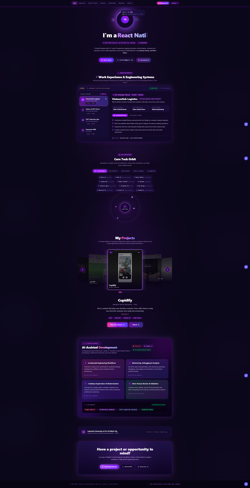
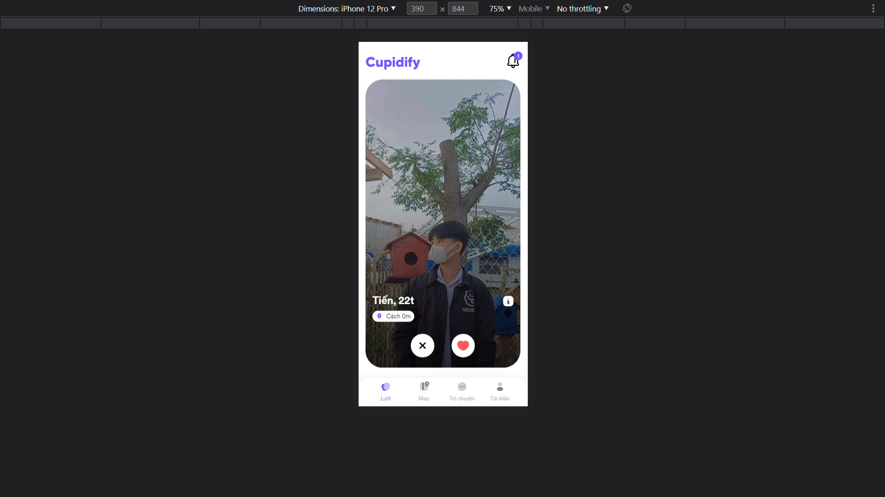
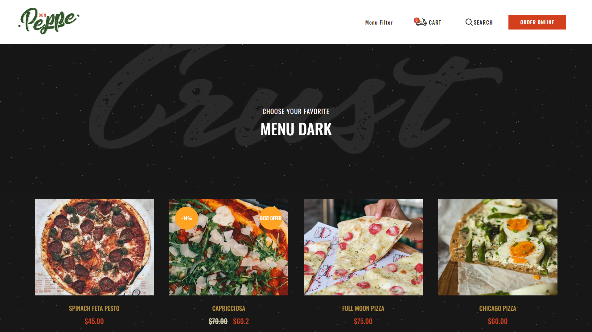
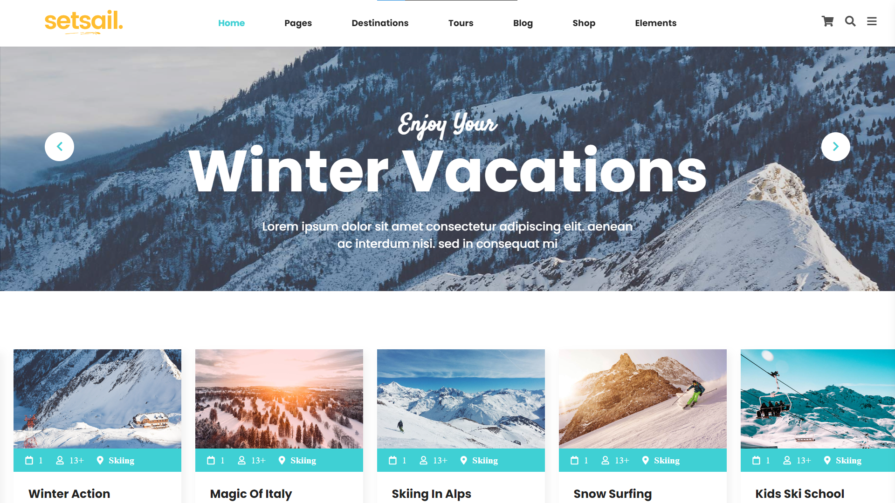
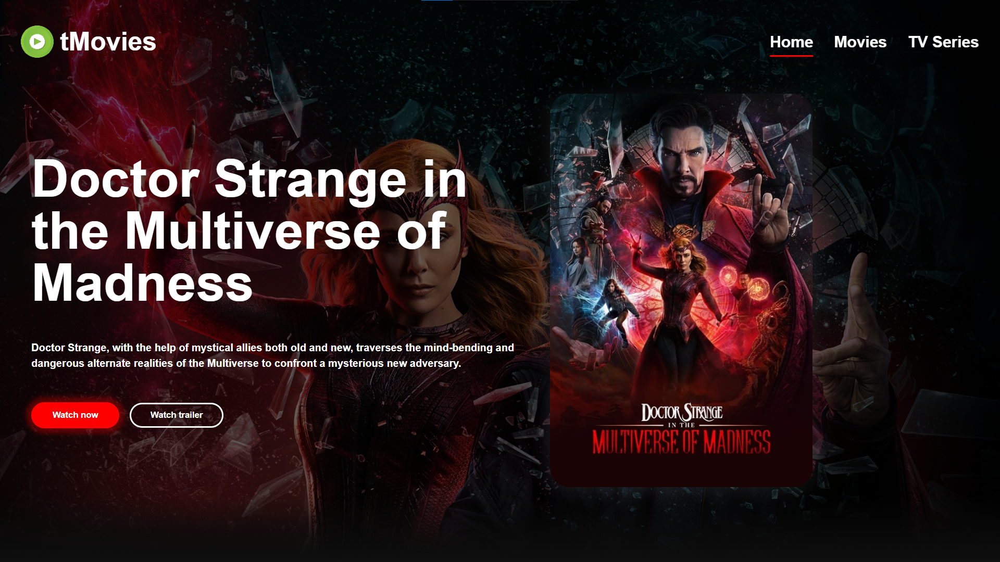

# Portfolio Website

A modern portfolio website for Frontend Engineer Đỗ Thành Danh, built with React, Vite, and TypeScript. The app presents work experience, technical expertise, projects, education, and downloadable CV in a polished purple-themed UI.

## Overview

This portfolio showcases:
- Personal profile and professional summary
- Experience timeline with enterprise project highlights
- Core skills and technology stack sections
- Legacy project showcase with real project images
- AI-assisted software development section
- Resume download and contact actions
- Responsive dark-themed portfolio layout

## Preview



### Project previews

<div align="center">
  
  
</div>

<div align="center">
  
  
</div>

## Tech Stack

- React 19
- Vite 6
- TypeScript
- Lucide React
- Motion (Framer Motion alternative)
- CSS / custom styling

## Getting Started

### Prerequisites

- Node.js 18+
- npm or pnpm

### Install dependencies

```bash
npm install
```

### Run locally

```bash
npm run dev
```

Then open the local URL shown in the terminal, typically:

```text
http://localhost:3000
```

## Available Scripts

```bash
npm run dev
```
Starts the Vite dev server for local development.

```bash
npm run build
```
Builds the app for production into the `dist` folder.

```bash
npm run preview
```
Serves the production build locally for preview.

```bash
npm run lint
```
Runs TypeScript checking without emitting files.

## Project Structure

```text
src/
  App.tsx
  main.tsx
  types.ts
  data/
    portfolioData.ts
  components/
    about/
    approach/
    common/
    contact/
    domains/
    education/
    experience/
    expertise/
    hero/
    layout/
    projects/
    resume/
    skills/
    templates/
  utils/
    downloadCV.ts
```

## Notes

- The portfolio uses real project assets from the older portfolio project instead of placeholder external images.
- Some project data and layout content are configured in `src/data/portfolioData.ts`.
- The UI templates live in `src/components/templates/` and can be swapped or customized based on your preferred portfolio style.

## License

This project is for personal portfolio use.

